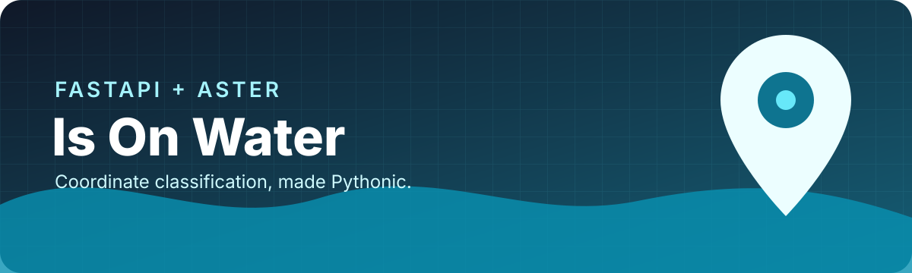

<div align="center">
  

  # Is On Water — Python

  **A local FastAPI service for classifying coordinates as ocean, river, lake, or land.**

  [](https://github.com/auroravicks/is-on-water/actions/workflows/ci.yml)
  [](https://www.python.org/)
  [](https://fastapi.tiangolo.com/)

  [Quick start](#quick-start) · [API](#api) · [Python usage](#python-usage) · [Go version](https://github.com/auroravicks/is-it-water-go)
</div>

---

Pass in latitude and longitude and receive a water-body classification derived
from NASA ASTER raster tiles. Everything runs locally: the service does not send
coordinates to an external geocoding provider.

## Highlights

- FastAPI endpoint with automatic interactive documentation
- Direct Python API for scripts and data pipelines
- Ocean, river, lake, land, and unknown classifications
- Local lookups against 1° × 1° ASTWBD GeoTIFF tiles
- Small application surface that is easy to adapt

## Quick start

### Requirements

- Python 3.10 or newer
- ASTWBD tile archives from [`is-on-water-dataset`](https://github.com/auroravicks/is-on-water-dataset)
- About 2 GB of disk space for the complete global tile set

```bash
git clone https://github.com/auroravicks/is-on-water.git
cd is-on-water
python -m venv .venv
```

Activate the environment and install dependencies:

```bash
# macOS / Linux
source .venv/bin/activate

# Windows PowerShell
.venv\Scripts\Activate.ps1

python -m pip install -r requirements.txt
git clone https://github.com/auroravicks/is-on-water-dataset.git ../is-on-water-dataset
DATASET_PATH=../is-on-water-dataset/dataset uvicorn main:app --reload
```

Open `http://127.0.0.1:8000/docs` for the interactive API explorer, or try:

```bash
curl http://127.0.0.1:8000/is-it-water/45.295504/12.61337
```

On Windows PowerShell, set `DATASET_PATH` before starting the server:

```powershell
$env:DATASET_PATH = "..\is-on-water-dataset\dataset"
uvicorn main:app --reload
```

## API

### `GET /is-it-water/{lat}/{lon}`

| Parameter | Type | Range | Description |
| --- | --- | --- | --- |
| `lat` | number | -90 to 90 | Latitude in decimal degrees |
| `lon` | number | -180 to 180 | Longitude in decimal degrees |

Example response:

```json
{
  "isWater": true,
  "feature": "OCEAN",
  "lat": 45.295504,
  "lon": 12.61337,
  "reqMs": 45
}
```

`UNKNOWN` means a matching tile or readable feature value was unavailable. It
should not be treated as a positive water classification.

## Python usage

```python
from water import is_in_water

feature = is_in_water(45.295504, 12.61337)
print(feature)  # OCEAN
```

To use tiles from another location, provide `dataset_path`:

```python
feature = is_in_water(45.295504, 12.61337, dataset_path="/data/astwbd")
```

## How it works

```text
latitude + longitude
        │
        ▼
derive the 1° ASTER tile ID
        │
        ▼
read the classification GeoTIFF from its ZIP
        │
        ▼
translate the coordinate to a raster pixel
        │
        ▼
map the pixel value to a feature label
```

## Project layout

```text
.
├── dataset/          # ASTWBD tile archives
├── main.py           # FastAPI application
├── water.py          # Raster lookup logic
├── test.py           # API integration checks
└── requirements.txt  # Runtime and test dependencies
```

## Development

```bash
python -m pip install -r requirements-dev.txt
ruff check .
ruff format --check .
```

The integration test expects the API to be running in another terminal:

```bash
uvicorn main:app
# another terminal
pytest
```

See [CONTRIBUTING.md](CONTRIBUTING.md) for contribution guidance.

## Data source

This project uses NASA's ASTER Water Body Dataset (ASTWBD), a global water mask
with approximately 30 m resolution at the equator. Dataset installation,
checksums, attribution, and citation guidance live in
[`auroravicks/is-on-water-dataset`](https://github.com/auroravicks/is-on-water-dataset).

The implementation was inspired by the original
[`NiciusB/is-on-water`](https://github.com/NiciusB/is-on-water) project by Nicius Balbona.

## Related project

Prefer Go? See [auroravicks/is-it-water-go](https://github.com/auroravicks/is-it-water-go).
